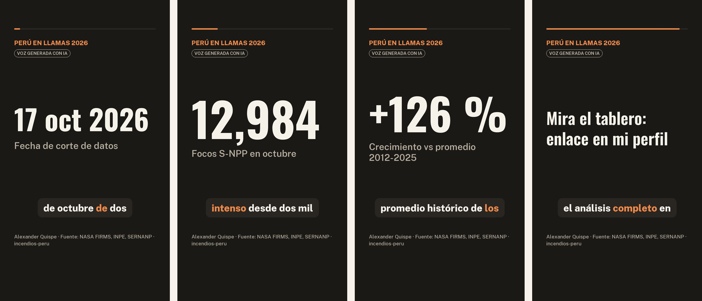

# Sesión 15 · Del texto a tu voz: reels con modelos abiertos

Un texto largo (un informe, una sentencia, un plan de gobierno) se convierte en un reel vertical de 30 a 60 segundos,
narrado con tu voz clonada y listo para Facebook, X o LinkedIn. Todos los modelos son abiertos y corren en una laptop.

**Slides de la clase:** https://claude.ai/artifact/TudArjkFRgH78hyb4GsfhH



| Paso | Modelo | Archivo |
|---|---|---|
| 1. Texto → guion por escenas y posts | Qwen3.8-27B (Alibaba, Apache 2.0), o el chat que prefieran | `guion.py` → `salidas/guion.json` |
| 2. Revisión del guion contra la fuente | ustedes | `salidas/guion.json` |
| 3. Guion → narración con tu voz | Qwen3-TTS (Alibaba) o VoxCPM2 (OpenBMB), Apache 2.0 | `hacer_reel.py` |
| 4. Narración → subtítulos y control de calidad | Whisper large-v3-turbo (MIT) | `hacer_reel.py` |
| 5. Video 1080×1920 con cifras, subtítulos y aviso de IA | Pillow + ffmpeg | `salidas/reel.mp4`, `reel.srt`, `portada.png`, `posts.md` |

## Contenido

| Archivo | Qué hace |
|---|---|
| `texto_a_reel.ipynb` | La clase paso a paso: guion, revisión, voz, WER, subtítulos, video y la comparación con VoxCPM2 |
| `guion.py` | Paso 1: arma el prompt, llama al modelo (o lee la respuesta de un chat) y verifica las cifras |
| `reel.py` | Pasos 3 a 5: voz clonada, subtítulos, control de calidad y video |
| `hacer_reel.py` | Corre los pasos 3 a 5 desde la terminal |
| `pruebas/medir_tts.py` | Cuánto tarda Qwen3-TTS por tamaño y dispositivo |
| `pruebas/estilos_voxcpm.py` | La misma frase con VoxCPM2, sin estilo y con estilo en inglés y en español |
| `pruebas/comparar_voces.py` | Ritmo y entonación de dos o más reels |
| `ejemplo/guion_incendios.json` | El guion de la prueba, con la corrección hecha a mano anotada en `revisado_a_mano` |

## Entorno

Va en un entorno propio, fuera del `pyproject.toml` del curso, porque `qwen-tts` fija `transformers==4.57.3`.

```bash
cd sessions/15-texto-a-reel
uv venv .venv
uv pip install --python .venv/bin/python qwen-tts faster-whisper pillow imageio-ffmpeg soundfile jiwer num2words pypdf
uv pip install --python .venv/bin/python voxcpm      # opcional, para la voz de locutor
```

Para el notebook, sumen `pandas matplotlib librosa jupyterlab` y ábranlo con `.venv/bin/jupyter lab texto_a_reel.ipynb`.
Su voz va en esta carpeta como `mi_voz.opus` (o `.m4a`, `.wav`); git la ignora.

En Windows la ruta es `.venv\Scripts\python`. La primera corrida baja unos 4 GB de modelos (2.3 GB la voz y 1.5 GB Whisper;
VoxCPM2 suma otros 4 GB). `ffmpeg` viene dentro de `imageio-ffmpeg` y las fuentes Oswald y Public Sans se bajan solas.

## Uso

```bash
# 1. Guion: copien el prompt, péguenlo en chat.qwen.ai, chat.deepseek.com o Claude y guarden la respuesta
.venv/bin/python guion.py --texto informe.pdf --solo-prompt > prompt.txt
.venv/bin/python guion.py --texto informe.pdf --respuesta respuesta.txt     # verifica las cifras y escribe salidas/guion.json

# 2. Lean salidas/guion.json y corrijan lo que el modelo exageró o inventó

# 3 a 5. Voz, subtítulos y video
.venv/bin/python hacer_reel.py --voz mi_voz.m4a --autor "Nombre Apellido" --fuente "BCRP, Reporte de Inflación" \
    --tts Qwen/Qwen3-TTS-12Hz-0.6B-Base

# La misma voz con estilo de locutor por escena y 8 % más rápida
.venv/bin/python hacer_reel.py --voz mi_voz.m4a --autor "Nombre Apellido" --fuente "BCRP" --motor voxcpm --velocidad 1.08
```

En una Mac con chip M añadan `--device mps`. Con `--salidas otra_carpeta` cada versión queda aparte (la carpeta necesita su
`guion.json`). Con 32 GB de RAM, el paso 1 también corre en local con Qwen3.8-27B (16 GB de descarga) en otro entorno:

```bash
uv venv .venv-llm && uv pip install --python .venv-llm/bin/python mlx-lm pypdf
.venv-llm/bin/python guion.py --texto informe.pdf
```

## Cómo grabar tu voz

- 10 a 25 segundos; una nota de voz de WhatsApp sirve (`.opus`, `.m4a`, `.ogg`).
- Un cuarto callado, sin música, a un palmo del micrófono: si satura, el clon hereda el ruido.
- Lean algo con el tono que quieren en el reel. El clon copia la energía de la grabación: una presentación tranquila da una narración tranquila.
- Whisper transcribe la grabación; no hace falta escribir lo que dijeron.
- En una MacBook con la tapa cerrada el micrófono interno queda desconectado por hardware: usen el celular o un micrófono externo.

## Lo que aprendimos

### Qué están liberando los laboratorios chinos (Hugging Face, 24 de octubre de 2026)

| Modelo | Laboratorio · licencia | Qué hace | ¿En una laptop? |
|---|---|---|---|
| DeepSeek-V4.1-Flash | DeepSeek · MIT | Texto e imágenes; n.º 1 en tendencia | No: 763B parámetros |
| Qwen3.8-27B | Alibaba · Apache 2.0 | Texto e imágenes; el más «likeado» | En una Mac de 32 GB (MLX, 4 bits) |
| Qwen3-TTS | Alibaba · Apache 2.0 | Clona una voz con segundos de audio | Sí, incluso en CPU |
| VoxCPM2 | OpenBMB · Apache 2.0 | Clona y acepta un estilo por frase | Sí |
| MiniMax-H3 | MiniMax | Video a partir de imagen y texto | No: GPU |
| Qwen-Image-2.1 | Alibaba | Imágenes | Solo con GPU |
| MiniMax-Music3, ACE-Step 1.5, YuE2 | MiniMax, ACE Studio + StepFun, HKUST | Música | En la práctica, GPU |

Casi todos los modelos grandes nuevos ven imágenes además de texto. Los gigantes no corren en una laptop, pero sus pesos son
abiertos y los sirven proveedores de Hugging Face.

### Tiempos medidos (Mac M5 Max)

| Paso | Chip de la Mac (`mps`) | Solo CPU |
|---|---|---|
| Guion con Qwen3.8-27B local (README de 2,023 palabras) | 33 a 42 s | — |
| Qwen3-TTS 0.6B, segundos de cálculo por segundo de audio | 0.8 a 1.0 | 1.4 |
| Qwen3-TTS 1.7B | 0.9 | 2.4 |
| VoxCPM2 | 0.6 | — |
| Reel completo de 50 s (voz, subtítulos y video) | 70 a 80 s | 110 s |

En laptops más modestas será más lento.

### Qwen3-TTS frente a VoxCPM2, con la misma voz y el mismo guion

| | Qwen3-TTS 1.7B | VoxCPM2 con estilo por escena y `--velocidad 1.08` |
|---|---|---|
| Duración | 55 s | 44 s |
| Ritmo al hablar | 2.5 palabras/s | 3.0 palabras/s |
| Entonación (desvío · rango p5-p95) | ±2.8 · 7.3 semitonos | ±2.5 · 7.9 semitonos |
| Audio | 24 kHz | 48 kHz |
| Peor escena según Whisper | 8 % de palabras mal entendidas | 8 % de palabras mal entendidas |

La diferencia clara es de ritmo. El efecto del estilo entre paréntesis no fue concluyente: en dos corridas de la misma frase,
el estilo en inglés subió la entonación en una (±2.20 → ±2.65) y casi nada en la otra (±2.75 → ±2.83). Lo que más cambia la
narración es cómo se grabó la referencia.

### Errores que vimos y cómo se resolvieron

- **Cifras correctas, frase falsa.** Qwen escribió que los incendios estaban «afectando» la Reserva Comunal Asháninka; el texto
  decía que el de Río Tambo está a 8.7 km. La verificación automática de cifras no lo detecta porque los números sí estaban en el
  texto. Otros borradores dijeron «el fuego está fuera de control» y, en un post, «en tiempo real». Se corrigió a mano (ver
  `ejemplo/guion_incendios.json`).
- **Prompt.** Tres cambios mejoraron el guion: pedir los números en palabras para la voz y en dígitos para la pantalla,
  pedir la fecha de corte de los datos y prohibir etiquetas como «gancho» o «invitación», que el modelo ponía en pantalla.
- **Hugging Face cobra.** La API de proveedores respondió `402 Payment Required` sin créditos. Por eso el paso 1 tiene tres
  caminos: chat gratuito, MLX en local o Hugging Face con créditos.
- **Dependencias incompatibles.** `qwen-tts` fija `transformers==4.57.3` y `mlx-lm` necesita `transformers` 5: van en entornos separados.
- **WER engañoso.** El texto dice «ciento veintiséis por ciento» y Whisper escribe «126%»: sin normalizar, una escena perfecta
  daba WER de 0.50. `reel._normalizar` pasa los números a palabras y quita tildes antes de comparar.
- **Subtítulos.** Whisper partía «8.7» en «8» y «.7», y escribía «Ashaninka» sin tilde. Se pegan los fragmentos y se le pasa el
  guion como contexto (`initial_prompt`).
- **Diseño.** Pillow dibuja desde la esquina de la caja de texto, no desde la línea base: la cifra grande pisaba su etiqueta
  hasta medir cada línea con `textbbox`.
- **Audio.** `faster-whisper` falló al abrir archivos por una versión de PyAV; se le pasa el audio ya decodificado con ffmpeg,
  que además lee las notas de voz de WhatsApp (`.opus`).

### Lo que revisamos y no usamos

- **Dessa (Block).** Modelo de conversación voz a voz en tiempo real, entrenado solo con audio. Es cerrado: no tiene pesos ni API,
  y el acceso es por lista de espera para investigadores de seguridad de IA. Además conversa en vez de leer un guion.
- **Generar música o video.** Los modelos existen y son abiertos, pero sin GPU no entran en una clase de 45 minutos.

### Ideas para otras sesiones

- **El Congreso en datos:** proyectos de ley de la API abierta del Congreso, temas con BERTopic y entidades con GLiNER.
  ¿Cuántos solo «declaran de interés nacional»?
- **Duelo de modelos que ven:** DeepSeek frente a Qwen convirtiendo fotos (carteles, portadas, gráficos) en filas de una tabla.
- **Voz en quechua:** OmniVoice (k2-fsa, 0.6B) lista 646 idiomas, entre ellos quechua ayacuchano y guaraní. Hay que revisar su
  licencia, que la ficha no declara.
- **Sentimiento en español** con pysentimiento y **traducción español–quechua** con NLLB-200.

## Reglas

- Clonen solo su propia voz, o la de alguien que lo autorizó por escrito.
- El video dice «Voz generada con IA» y los posts también.
- Nada se publica sin que una persona haya leído el guion completo contra la fuente.
- Las carpetas `salidas*/` no se versionan: ahí quedan su voz y sus videos.
