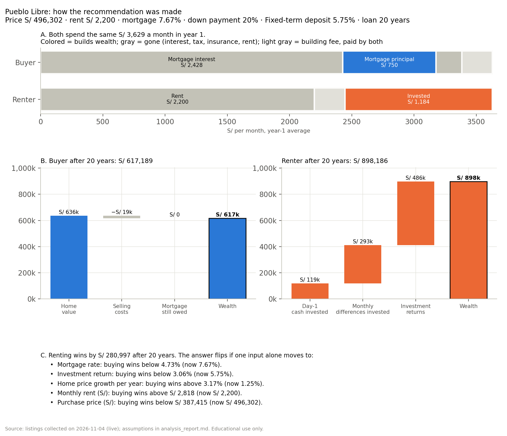

# Example: buy or rent in Pueblo Libre, Jesús María or Magdalena del Mar?

A real run of the [`buy-vs-rent`](../Skill_Buy_Rent) skill, done the way it runs for any user: the orchestrator
creates the run, two agents search the web in parallel, the analysis agent runs the model, and the dashboard agent
checks the app and draws the figures. Listings were collected live on 3–4 November 2026.

> Educational use only. Not personalized financial, tax or investment advice.

## The search

| Question | Answer |
|---|---|
| Price range | S/ 450,000 – 550,000 |
| Size and bedrooms | At least 60 m², at least 2 bedrooms |
| Districts | Pueblo Libre, Jesús María, Magdalena del Mar |
| Down payment | 20% (assumed for this example) |
| Extras | Building less than 10 years old |

The answers are in [`answers.json`](answers.json). In Claude Code the same run starts with `/buy-vs-rent` and these
answers to the five questions.

## How it ran

| Step | Who | What happened |
|---|---|---|
| 1. Intake | Orchestrator | `new-run` validated the answers: "Jesus Maria" → Jesús María, "Magdalena" → Magdalena del Mar, "less than 10 years old" → `max_age_years: 10` |
| 2a. Listings | `market-data` agent | Urbania, Adondevivir, Properati, MercadoLibre, Babilonia, Nestoria and Trovit blocked automated access (HTTP 401/403); all 266 listings come from InfoCasas, each with its URL. Used units with no construction year were skipped because the 10-year filter could not be checked |
| 2b. Investments | `opportunity-cost` agent | Deposit rates by bank, S&P 500 total return (Yahoo Finance) and the BCRP Lima stock-exchange series, in parallel with 2a |
| 3. Analysis | `financial-analysis` agent | 3 districts × 5 horizons × 5 mortgage rates × 3 investment options = 225 scenarios |
| 4. Dashboard | `streamlit-builder` agent | App check passed (it starts, and each slider changes the result); 10 figures exported |

## What was found

| District | Sale listings used | Realistic price (median) | Rent listings used | Realistic rent | Building fee |
|---|---:|---:|---:|---:|---:|
| Pueblo Libre | 30 | S/ 496,302 | 25 | S/ 2,200 | S/ 245 |
| Jesús María | 30 | S/ 488,170 | 36 | S/ 2,500 | S/ 250 |
| Magdalena del Mar | 16 | S/ 528,352 | 21 | S/ 2,500 | S/ 235 |

| Market parameter | Value | Source |
|---|---:|---|
| Average mortgage rate (soles) | 7.67% | SBS, 3 Nov 2026 |
| Inflation (Lima CPI, 12 months) | 4.55% | BCRP, Sep 2026 |
| House price growth (5-year average) | 1.25% / year | BCRP price index for these districts |
| Rent growth | 0.39% / year | BCRP CPI rent component |
| Fixed-term deposit / S&P 500 / Lima stock exchange (base return) | 5.75% / 10.39% / 7.74% | Bank rate sheets, Yahoo Finance, BCRP |

Buying and selling costs, property tax and insurance could not be sourced. The model used the labelled assumptions in
`defaults.yaml` (4%, 3%, 0.2% and 0.3%) and shows them as warnings.

## Result

**Renting and investing the difference beats buying in all three districts, at every horizon from 5 to 30 years.**

| District | 5 years | 10 years | 15 years | 20 years | 30 years |
|---|---|---|---|---|---|
| Pueblo Libre | rent (0%) | rent (0%) | rent (0%) | rent (0%) | rent (0%) |
| Jesús María | rent (0%) | rent (7%) | rent (7%) | rent (7%) | rent (7%) |
| Magdalena del Mar | rent (0%) | rent (0%) | rent (0%) | rent (0%) | rent (0%) |

The percentage is the share of the 15 scenarios (5 mortgage rates × 3 investments) in which buying wins.

At the market mortgage rate and against the safest option (the fixed-term deposit), the renter ends up ahead by:

| District | After 10 years | After 20 years |
|---|---:|---:|
| Pueblo Libre | S/ 123,145 | S/ 280,997 |
| Jesús María | S/ 66,367 | S/ 123,680 |
| Magdalena del Mar | S/ 105,363 | S/ 227,375 |

### How the recommendation was made

Both households start with the same cash and spend the same amount every month; only where the money ends up
differs. Pueblo Libre, after 20 years, at the market mortgage rate and against the fixed-term deposit:

| Step | Buyer | Renter |
|---|---|---|
| Day 1 | Pays S/ 119,112 (down payment + buying costs) | Invests the same S/ 119,112 |
| Each month (year 1), S/ 3,629 | S/ 2,428 interest, S/ 750 loan principal, S/ 207 tax and insurance, S/ 245 fee | S/ 2,200 rent, S/ 245 fee, **invests S/ 1,184** |
| After 20 years | Home S/ 636,277 − selling costs S/ 19,088 − loan S/ 0 = **S/ 617,189** | S/ 119,112 + S/ 292,810 saved + S/ 486,263 returns = **S/ 898,186** |

Three quarters of the buyer's mortgage payment is interest, while the renter puts a third of the same monthly amount into
savings that compound at 5.75%. The home only grows 1.25% a year. Three comparisons decide it, and all three point
to renting in every district:

- **Rent vs borrowing:** one year of rent is 5.3–6.1% of the price; the mortgage costs 7.67%.
- **Home vs investment:** homes grew 1.25% a year; the safest investment pays 5.75%.
- **Home vs inflation:** 1.25% growth against 4.55% inflation means the home loses value in real terms.

What would flip it after 20 years (one input at a time, everything else as above):

| District | Mortgage rate below | Home price growth above | Rent above | Price below |
|---|---:|---:|---:|---:|
| Pueblo Libre | 4.73% | 3.17% / year | S/ 2,818 | S/ 387,415 |
| Jesús María | 6.39% | 2.19% / year | S/ 2,772 | S/ 440,244 |
| Magdalena del Mar | 5.46% | 2.77% / year | S/ 3,000 | S/ 440,244 |

Jesús María is the closest call. The full steps for each district are in `analysis_report.md` ("How the
recommendation was made"), in `figures/<district>_explained_20y.png`, and in section 2 of the dashboard, where every
number updates as you move the controls.



Before relying on it:

- Asking prices are not closing prices: try the negotiation discount slider.
- Many of the sale units are still under construction (17 of 30 in Pueblo Libre, 14 of 30 in Jesús María).
- All listings come from one portal, because the others blocked automated access.
- Interest on deposits is tax-free only until 31 Dec 2026; taxes on the three investments are listed as unknowns.

## Files

```text
Example/
├── answers.json                     the five answers
├── outputs/
│   ├── validation.txt               summary of the final validation
│   └── 20261103-2350-pueblo-libre-jesus-maria-magdalena/
│       ├── inputs.json              normalized search
│       ├── raw_listings_live.csv    listings as collected
│       ├── listings.csv             cleaned listings with flags and URLs
│       ├── market_summary.json      per-district statistics
│       ├── housing_params.json      mortgage rates, growth, costs, inflation (with sources)
│       ├── opportunity_costs.json   the three investment options
│       ├── market_log.md            portals tried, pages fetched, what was skipped
│       ├── opportunity_log.md       pages used for the returns
│       ├── analysis_results.csv     the 225 scenarios
│       ├── analysis_summary.json    verdicts, break-even years, sensitivity, warnings
│       ├── analysis_report.md       one-page report
│       └── validation.txt
└── figures/
    ├── verdicts.png
    ├── <district>_wealth.png        buyer vs renter wealth over 30 years
    ├── <district>_heatmap_20y.png   buy minus rent after 20 years
    └── <district>_explained_20y.png how the recommendation was made (monthly money, final wealth, flip points)
```


## Open the dashboard

From this folder, in any terminal (PowerShell, cmd, Git Bash, macOS/Linux):

```bash
cd "C:\Users\<you>\Documents\GitHub\Data-Science-Python\sessions\16-skills-enaho\Example"
python run_dashboard.py
```

Your browser opens http://localhost:8501. Stop the server with **Ctrl+C** in the terminal. The dashboard works
offline from the files in `outputs/`; no install step is needed (it uses the engine in `../Skill_Buy_Rent`).

The page opens with the verdict, followed by **"How the recommendation was made"**: six steps with the actual
numbers (the listings behind the price, where the same monthly money goes, what each household owns at the end,
the three comparisons that decide it, the scenario vote behind "rent", and the values that would flip it). In the
sidebar, pick a district and move the mortgage rate, down payment, investment option and return, purchase price,
negotiation discount, loan term, and price and rent growth; every step updates at once.

### Calling the launcher directly

`run_dashboard.py` is a shortcut for this command (from this folder):

| Shell | Command |
|---|---|
| PowerShell | `python ..\Skill_Buy_Rent\.claude\skills\buy-vs-rent\scripts\hl.py dashboard --run outputs\20261103-2350-pueblo-libre-jesus-maria-magdalena` |
| Git Bash / macOS / Linux | `python ../Skill_Buy_Rent/.claude/skills/buy-vs-rent/scripts/hl.py dashboard --run outputs/20261103-2350-pueblo-libre-jesus-maria-magdalena` |

If you installed the skills (`python ..\Skill_Buy_Rent\install.py`), the same launcher is also at
`$HOME\.claude\skills\buy-vs-rent\scripts\hl.py` in PowerShell or `~/.claude/skills/buy-vs-rent/scripts/hl.py` in
bash. Note that PowerShell does not expand `~` for Python, so use `$HOME` there.

Other launcher commands for this run, same pattern:

| Command | What it does |
|---|---|
| `... hl.py figures --run outputs\<run-id>` | Regenerate the PNGs in `figures/` |
| `... hl.py check-app --run outputs\<run-id>` | Check that the dashboard starts and its sliders work |
| `... hl.py summary --run outputs\<run-id>` | Print the short summary |
