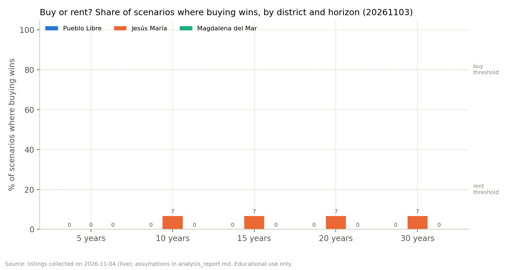

# Example: buy or rent in Pueblo Libre, Jesús María or Magdalena del Mar?

A real run of the [`buy-vs-rent`](../Skill_Buy_Rent) skill, done the way it runs for any user: the orchestrator
creates the run, two agents search the web in parallel, the analysis agent runs the model, and the dashboard agent
checks the app and draws the figures. Listings were collected live on 3–4 November 2026.

> Educational use only. Not personalized financial, tax or investment advice.

## The search

| Question | Answer |
|---|---|
| Price range | S/ 450,000 – 550,000 |
| Size and bedrooms | At least 60 m², at least 2 bedrooms |
| Districts | Pueblo Libre, Jesús María, Magdalena del Mar |
| Down payment | 20% (assumed for this example) |
| Extras | Building less than 10 years old |

The answers are in [`answers.json`](answers.json). In Claude Code the same run starts with `/buy-vs-rent` and these
answers to the five questions.

## How it ran

| Step | Who | What happened |
|---|---|---|
| 1. Intake | Orchestrator | `new-run` validated the answers: "Jesus Maria" → Jesús María, "Magdalena" → Magdalena del Mar, "less than 10 years old" → `max_age_years: 10` |
| 2a. Listings | `market-data` agent | Urbania, Adondevivir, Properati, MercadoLibre, Babilonia, Nestoria and Trovit blocked automated access (HTTP 401/403); all 266 listings come from InfoCasas, each with its URL. Used units with no construction year were skipped because the 10-year filter could not be checked |
| 2b. Investments | `opportunity-cost` agent | Deposit rates by bank, S&P 500 total return (Yahoo Finance) and the BCRP Lima stock-exchange series, in parallel with 2a |
| 3. Analysis | `financial-analysis` agent | 3 districts × 5 horizons × 5 mortgage rates × 3 investment options = 225 scenarios |
| 4. Dashboard | `streamlit-builder` agent | App check passed (it starts, and each slider changes the result); 7 figures exported |

## What was found

| District | Sale listings used | Realistic price (median) | Rent listings used | Realistic rent | Building fee |
|---|---:|---:|---:|---:|---:|
| Pueblo Libre | 30 | S/ 496,302 | 25 | S/ 2,200 | S/ 245 |
| Jesús María | 30 | S/ 488,170 | 36 | S/ 2,500 | S/ 250 |
| Magdalena del Mar | 16 | S/ 528,352 | 21 | S/ 2,500 | S/ 235 |

| Market parameter | Value | Source |
|---|---:|---|
| Average mortgage rate (soles) | 7.67% | SBS, 3 Nov 2026 |
| Inflation (Lima CPI, 12 months) | 4.55% | BCRP, Sep 2026 |
| House price growth (5-year average) | 1.25% / year | BCRP price index for these districts |
| Rent growth | 0.39% / year | BCRP CPI rent component |
| Fixed-term deposit / S&P 500 / Lima stock exchange (base return) | 5.75% / 10.39% / 7.74% | Bank rate sheets, Yahoo Finance, BCRP |

Buying and selling costs, property tax and insurance could not be sourced. The model used the labelled assumptions in
`defaults.yaml` (4%, 3%, 0.2% and 0.3%) and shows them as warnings.

## Result

**Renting and investing the difference beats buying in all three districts, at every horizon from 5 to 30 years.**

| District | 5 years | 10 years | 15 years | 20 years | 30 years |
|---|---|---|---|---|---|
| Pueblo Libre | rent (0%) | rent (0%) | rent (0%) | rent (0%) | rent (0%) |
| Jesús María | rent (0%) | rent (7%) | rent (7%) | rent (7%) | rent (7%) |
| Magdalena del Mar | rent (0%) | rent (0%) | rent (0%) | rent (0%) | rent (0%) |

The percentage is the share of the 15 scenarios (5 mortgage rates × 3 investments) in which buying wins.

At the market mortgage rate and against the safest option (the fixed-term deposit), the renter ends up ahead by:

| District | After 10 years | After 20 years |
|---|---:|---:|
| Pueblo Libre | S/ 123,145 | S/ 280,997 |
| Jesús María | S/ 66,367 | S/ 123,680 |
| Magdalena del Mar | S/ 105,363 | S/ 227,375 |

Why: prices in these districts grew 1.25% a year (below 4.55% inflation), the mortgage costs 7.67%, and rent is only
about 5–6% of the price per year. Buying only wins in Jesús María when the mortgage rate falls to about 5.7% and the
alternative is the deposit. Change any of these in the dashboard to see where the answer flips.

Before relying on it:

- Asking prices are not closing prices: try the negotiation discount slider.
- Many of the sale units are still under construction (17 of 30 in Pueblo Libre, 14 of 30 in Jesús María).
- All listings come from one portal, because the others blocked automated access.
- Interest on deposits is tax-free only until 31 Dec 2026; taxes on the three investments are listed as unknowns.

## Files

```text
Example/
├── answers.json                     the five answers
├── outputs/
│   ├── validation.txt               summary of the final validation
│   └── 20261103-2350-pueblo-libre-jesus-maria-magdalena/
│       ├── inputs.json              normalized search
│       ├── raw_listings_live.csv    listings as collected
│       ├── listings.csv             cleaned listings with flags and URLs
│       ├── market_summary.json      per-district statistics
│       ├── housing_params.json      mortgage rates, growth, costs, inflation (with sources)
│       ├── opportunity_costs.json   the three investment options
│       ├── market_log.md            portals tried, pages fetched, what was skipped
│       ├── opportunity_log.md       pages used for the returns
│       ├── analysis_results.csv     the 225 scenarios
│       ├── analysis_summary.json    verdicts, break-even years, sensitivity, warnings
│       ├── analysis_report.md       one-page report
│       └── validation.txt
└── figures/
    ├── verdicts.png
    ├── <district>_wealth.png        buyer vs renter wealth over 30 years
    └── <district>_heatmap_20y.png   buy minus rent after 20 years
```



## Open the dashboard

Install the skills once (from `../Skill_Buy_Rent`: `python install.py`), then from this folder:

```bash
cd sessions/16-skills-enaho/Example
python ~/.claude/skills/buy-vs-rent/scripts/hl.py dashboard --run outputs/20261103-2350-pueblo-libre-jesus-maria-magdalena
```

Without installing, use the launcher inside the repository:

```bash
python ../Skill_Buy_Rent/.claude/skills/buy-vs-rent/scripts/hl.py dashboard --run outputs/20261103-2350-pueblo-libre-jesus-maria-magdalena
```

It opens at http://localhost:8501 (stop it with Ctrl+C). It works offline from the files in `outputs/`. In the
sidebar, pick a district and move the mortgage rate, down payment, investment option and return, purchase price,
negotiation discount, loan term, and price and rent growth; the verdict cards, heat map and wealth chart update at
once.

To regenerate the figures or re-check the run:

```bash
python ~/.claude/skills/buy-vs-rent/scripts/hl.py figures   --run outputs/20261103-2350-pueblo-libre-jesus-maria-magdalena
python ~/.claude/skills/buy-vs-rent/scripts/hl.py check-app --run outputs/20261103-2350-pueblo-libre-jesus-maria-magdalena
```
