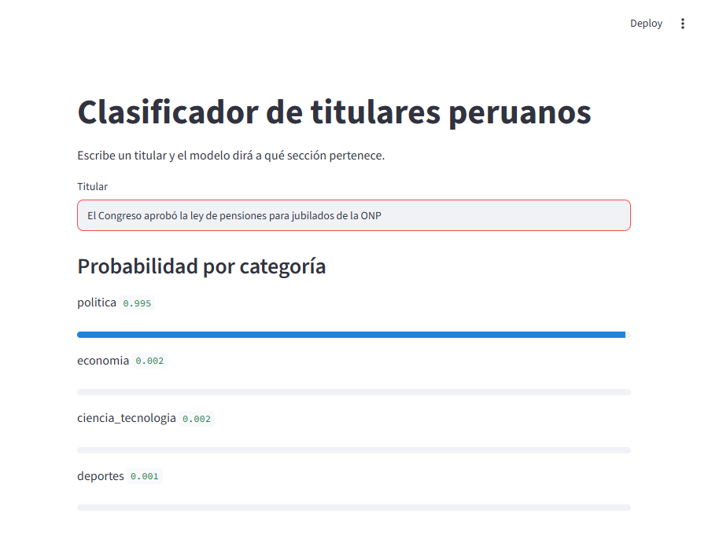

# Tarea 1: clasificador de titulares (La República y El Comercio)

**Pregunta:** ¿Puede un modelo pequeño aprender a clasificar un titular peruano en política, economía, deportes o ciencia/tecnología, y cuánto mejora frente a no entrenarlo?

Autor: Roddy Huarhua (@roddyhuarhua-hub) · Opción C (comparada): 200 de La República + 200 de El Comercio · Entrega: 18 de octubre de 2026

## Qué hay aquí

| Archivo | Para qué sirve |
|---|---|
| `01_recoleccion.ipynb` | Lectura de feeds RSS, limpieza, CSV con 7 columnas y tres gráficos |
| `02_clasificacion.ipynb` | Etiquetado con LLM, validación humana, zero-shot y fine-tuning |
| `app.py` | Dashboard en Streamlit |
| `datos/` | `noticias.csv`, `etiquetas_llm.csv`, muestras de revisión humana y el split (`entrenamiento`, `validacion`, `prueba`) |
| `modelo/` | Configuración y tokenizador del modelo (sin los pesos, ver abajo) |
| `BITACORA.md` | Decisiones tomadas, con su evidencia |

## Cómo correrlo

```bash
pip install -r requirements.txt
streamlit run app.py
```

Para etiquetar con el LLM hace falta una clave de Anthropic en un archivo `.env`: `ANTHROPIC_API_KEY=...`

## Datos

- **Medios:** La República y El Comercio (opción C, meta 200 + 200).
- **Fechas de extracción:** 13 y 14 de octubre de 2026. Se corre `01_recoleccion.ipynb` una vez al día y se acumula por URL, porque cada feed RSS cubre solo unos 2 días.
- **Fuente:** feeds RSS oficiales, listados en el `robots.txt` de cada diario.
- **Titulares recolectados:** **562** en total: La República 249, El Comercio 313.
- **Utilizables para el clasificador** (sin `otra`): **546**, con La República 242 y El Comercio 304, ambos sobre la meta de 200.
- **Fechas de publicación:** El Comercio, 8 a 14 de octubre de 2026. La República, de marzo de 2021 a octubre de 2026 (ver limitaciones).
- La República rota despacio en el RSS; para llegar a la meta se siguieron enlaces entre notas (sin paginación, con tope y pausa).
- Descartados por no encajar en las 4 categorías (sociedad, espectáculos, mundo, etc.): ver sección 5 del notebook 01.

### Mapeo de secciones a categorías

`seccion_original` es el primer tramo de la URL. La categoría sale de este mapeo explícito:

| `seccion_original` (URL) | Categoría |
|---|---|
| `politica` | politica |
| `economia` | economia |
| `deportes`, `deporte-total` | deportes |
| `ciencia`, `tecnologia` | ciencia_tecnologia |
| cualquier otra | se descarta |

### Ética del scraping

- Se respetó `robots.txt` de ambos diarios (se consulta con `RobotFileParser` en el notebook).
- Se usó RSS en lugar de scrapear HTML: La República prohíbe la paginación y ofrece `/rss/` como canal público.
- User-Agent descriptivo con contacto.
- Pausa de 1 a 2 segundos entre pedidos y un solo reintento.

## Resultados (conjunto de prueba)

| Métrica | Valor |
|---|---|
| F1 macro, BETO ajustado | **0.933** (accuracy 0.94) |
| F1 macro, zero-shot (BETO-XNLI) | 0.707 (accuracy 0.72) |
| Acuerdo LLM-humano | 34 / 40 (85 %): 20/20 en la primera muestra y 14/20 en la segunda |

Split estratificado 70 / 15 / 15 con `random_state=42`: 382 titulares de entrenamiento, 82 de validación y 82 de prueba. La validación sirvió para elegir la época; la prueba se usó una sola vez.
F1 por clase del modelo ajustado: deportes 1.00, economía 0.92, ciencia/tecnología 0.92, política 0.90.

## Hallazgos

1. **Los dos medios cubren distinto.** Deportes es el 42 % de los titulares de El Comercio (132 de 313) frente al 20 % de La República (50 de 249); en cambio, política pesa 33 % en La República y 19 % en El Comercio.
2. **Entrenar importa, sobre todo en economía.** El ajuste fino sube el F1 macro de 0.707 a 0.933. La mayor ganancia está en economía: el zero-shot solo recupera la mitad de las notas (recall 0.50); el modelo ajustado llega a 0.94.

Un tercer dato útil (gráfico 2 del notebook 01): la sección del diario no es una etiqueta limpia. El LLM coincide con la sección en el 90 % de los casos, pero en economía de La República baja al 75 %: allí caen notas de pensiones, AFP y feriados que tratan de política.

## Limitaciones

1. **La verdad es la etiqueta de un LLM, no una humana.** El F1 mide cuánto reproduce el modelo al LLM (Claude Haiku 5.5); frente a un humano el techo es el 85 % de acuerdo. En 7 de 20 notas de la segunda muestra el humano marcó `otra` (guías y servicios) y el LLM solo en 1; se decidió no aplicar ese criterio más estricto al entrenamiento (`BITACORA.md`, D11).
2. **Datos poco homogéneos en el tiempo.** El Comercio cubre solo una semana, mientras que 77 de las 249 notas de La República son anteriores a septiembre de 2026 (guías atemporales traídas al seguir enlaces). El modelo podría aprender rasgos del medio además de la categoría.
3. **Evaluación pequeña.** Un solo split y una sola semilla, con 82 notas de prueba: el F1 tiene un margen de varios puntos. Tómese como "alrededor de 0.9".

## Modelo

Los pesos pesan más de 100 MB y no se suben a GitHub. Para regenerarlos, correr
`02_clasificacion.ipynb` completo.

## Dashboard

Se corre en local con `streamlit run app.py` (requiere el modelo en `modelo/`). Verificado el 14 de octubre:
el servidor levanta y el modelo clasifica correctamente titulares de prueba de las cuatro categorías.


