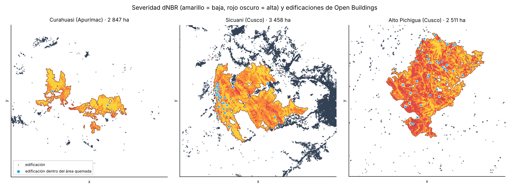

# ¿A quién alcanza el fuego? · Incendios del sur andino y Open Buildings

Tarea en clase · Ciencia de Datos con Python · 21 de octubre de 2026 · Roddy Huarhua

**Dashboard 3D:** https://claude.ai/artifact/LDS3s7zx2CybxJ9RFKy4No



## La pregunta

Reto **D · ¿A quién afecta?** En 7 incendios del sur andino (Apurímac, Cusco y Arequipa,
setiembre y octubre de 2026), ¿cuántas edificaciones quedaron dentro del área quemada o
cerca de ella? En lugar de contar personas con WorldPop (píxeles de 1 km), cuento cada
techo con Google Open Buildings.

## Los datos y sus fechas

| Dato | Fuente | Tipo | Fecha |
|---|---|---|---|
| Huella y severidad dNBR | Sentinel-2 L2A (Planetary Computer), del monitor de incendios del curso | Raster ~23 m | pre: 25 set – 7 oct; post: 13 – 15 oct 2026 |
| Focos de calor | VIIRS S-NPP, NOAA-20, NOAA-21 (NASA FIRMS, INPE) | Puntos | 1 jul – 17 oct 2026 |
| Edificaciones | [Google Open Buildings v3](https://sites.research.google/gr/open-buildings/), tile S2 `917` | Polígonos → centroides | imágenes hasta mayo 2023 |
| Población a ≤ 5 km de los focos | WorldPop 2020, calculada en el monitor del curso | Raster 1 km → tabla | 2020 |
| Relieve (dashboard) | AWS Terrain Tiles | Raster | – |

Nubes (% de la zona sin dato limpio en Sentinel-2): Curahuasi 14 %, Coyllurqui 16 %,
Huanoquite 7 %, el resto 0 %.

## Método

1. Abrir cada raster dNBR con `rasterio` y **validar** las hectáreas por clase contra el monitor (diferencia < 0,1 %).
2. Bajar Open Buildings leyendo el tile `917` (340 MB) en streaming y quedarme con las edificaciones a ≤ 5 km de cada incendio. Filtrar confianza ≥ 0,70 (queda el 85 %).
3. Proyectar a UTM (18S / 19S) y medir la distancia de cada edificación al borde quemado, **en metros**.
4. Raster → punto: leer la severidad dNBR bajo cada techo con `rasterio.sample`.
5. Vector → raster: densidad de edificaciones en celdas de 100 m y `zonal_stats` por anillo (dentro, 0–1 km, 1–5 km).

Todo está en [`incendios_open_buildings.ipynb`](incendios_open_buildings.ipynb).

## Resultados

| Distrito | ha quemadas | Dentro | ≤ 500 m | ≤ 1 km | ≤ 5 km | Población ≤ 5 km |
|---|---:|---:|---:|---:|---:|---:|
| Sicuani (Canchis, Cusco) | 3 458 | 55 | 2 700 | 4 653 | 45 512 | 44 869 |
| Coyllurqui (Cotabambas, Apurímac) | 1 647 | 14 | 576 | 652 | 3 949 | 3 143 |
| Toro (La Unión, Arequipa) | 1 004 | 1 | 77 | 311 | 604 | 500 |
| Alto Pichigua (Espinar, Cusco) | 2 511 | 82 | 176 | 246 | 1 344 | 657 |
| San Pedro de Cachora (Abancay, Apurímac) | 1 451 | 8 | 49 | 120 | 3 676 | 4 466 |
| Huanoquite (Paruro, Cusco) | 379 | 1 | 74 | 113 | 510 | 1 533 |
| Curahuasi (Abancay, Apurímac) | 2 847 | 2 | 28 | 74 | 1 682 | 3 114 |
| **Total** | **13 297** | **163** | **3 680** | **6 169** | **57 277** | **58 282** |

## Tres hallazgos

1. **El riesgo está en el borde, no en el centro.** Los 7 incendios quemaron 13 297 ha, pero solo 163 edificaciones quedaron dentro. En la franja de 1 km hay 6 169: 38 veces más.
2. **Sicuani concentra el 75 % de la exposición.** 4 653 edificaciones a ≤ 1 km, 44 869 personas a ≤ 5 km (77 % de las 58 282 del total) y 2 700 edificaciones a ≤ 500 m del borde quemado: el fuego llegó a la periferia de la ciudad.
3. **Alto Pichigua (Espinar) es el caso opuesto.** Pocas edificaciones, pero 82 quedaron dentro del área quemada y 8 con severidad moderada alta. Son estancias altoandinas dispersas que un conteo de población a 1 km no ve.

## Limitaciones

- Un foco de calor no es un incendio, y el dNBR no es el área oficial de SERFOR ni INDECI.
- Las nubes esconden el fuego: las hectáreas son un piso.
- Open Buildings es de 2023 o antes: mide exposición, no daño.
- Una edificación no es una vivienda: puede ser corral, depósito o local comunal (en Alto Pichigua hay 0,5 personas por edificación).
- La población (WorldPop 2020, 1 km) se mide desde los focos VIIRS, no desde el borde dNBR, y no ve caseríos pequeños.
- Distancia en línea recta, sin viento, pendiente ni quebradas.

## Cómo correrlo

```bash
pip install -r requirements.txt
jupyter notebook incendios_open_buildings.ipynb
```

Los datos ya están en `datos/`. Para volver a bajar Open Buildings, poner `DESCARGAR = True` en el notebook.
